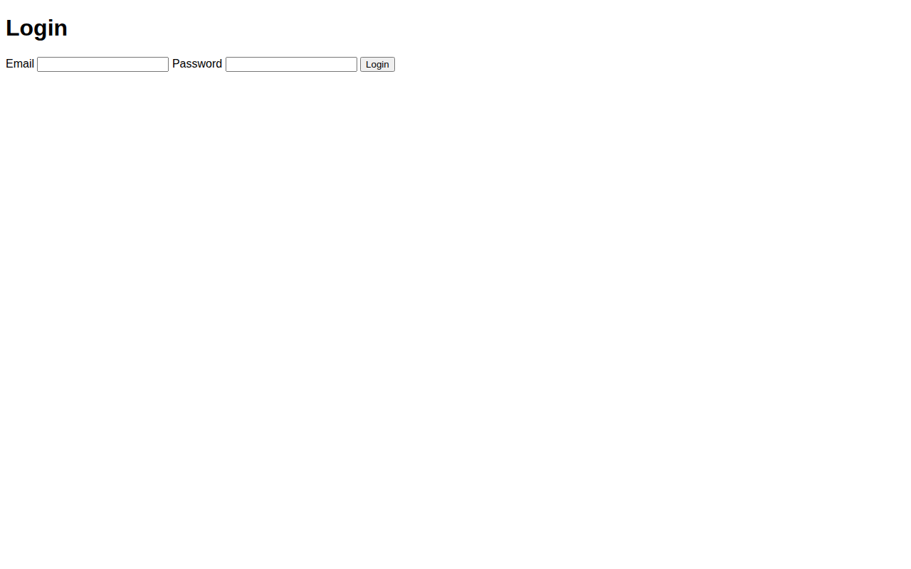

# Short URL App with User Authentication

A URL shortener where short links are created behind login-only routes, with visit-history tracking and cookie-based sessions. Sign up, log in, shorten a URL, and see every visit it gets.



## Features

- **User auth** — sign up and log in, with cookie-based sessions
- **Short links, login-only** — creating a short URL requires being logged in
- **Redirects with visit history** — each visit to a short link is recorded with a timestamp
- **EJS views** — server-rendered login, signup, and home pages

## Tech Stack

- Node.js + Express 4
- MongoDB + Mongoose
- EJS templates, cookie-parser
- nanoid / shortid for short IDs, uuid

## How to Run

All of the code lives in the `short-url-nodejs-main/` folder (the project was committed as an extracted folder).

```bash
cd short-url-nodejs-main
npm install
npm start
```

Then open `http://localhost:8001`.

You need MongoDB running. By default it connects to `mongodb://localhost:27017/short-url`; override with the `MONGODB` environment variable:

```bash
MONGODB=mongodb://localhost:27017/short-url npm start
```

`npm start` runs the server with nodemon.

## Notes

- The screenshot above is the login page — the app redirects unauthenticated visitors there.
- Short-link creation (`/url`) is protected: only logged-in users can create links.
